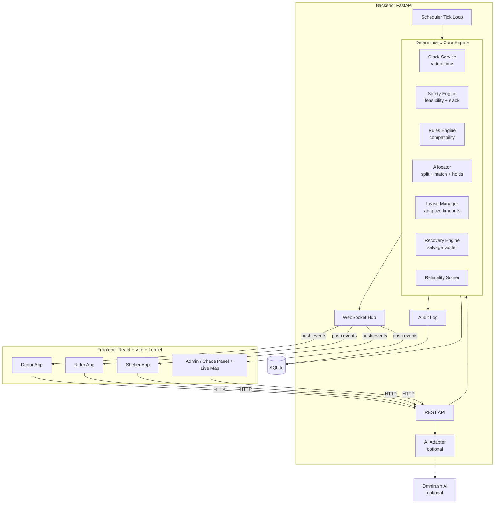
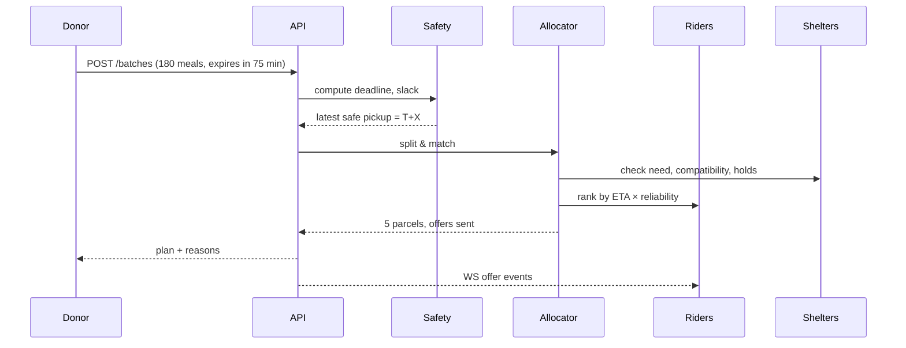
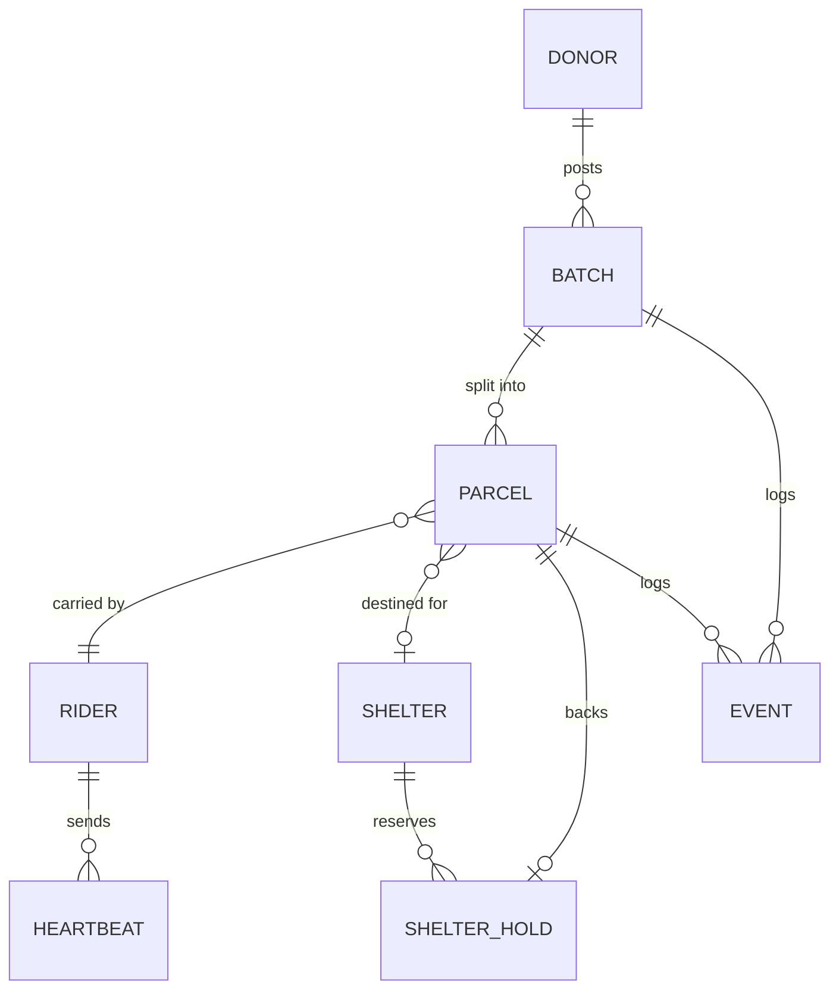
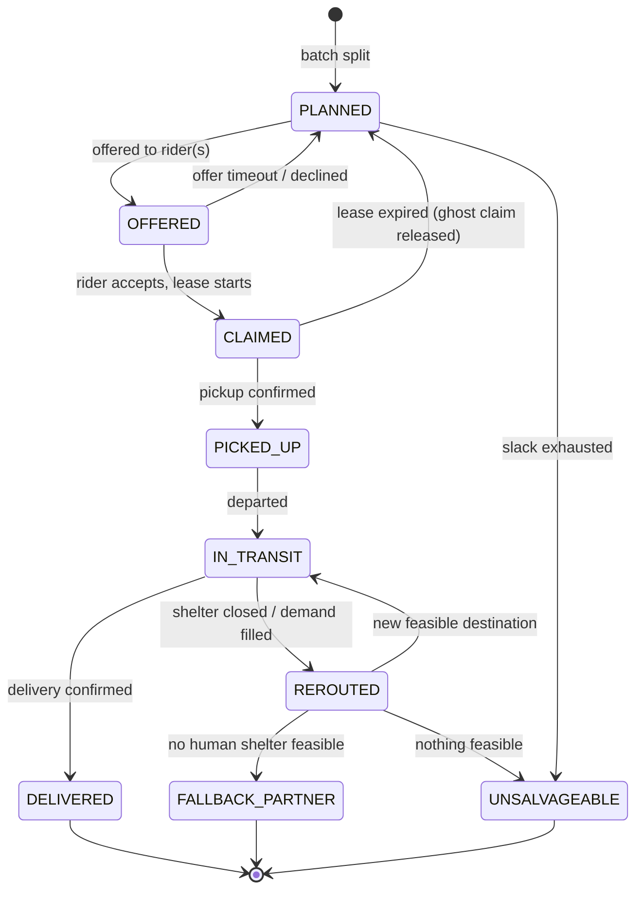

# RelayGrid

### Real-time coordination, dispatch and safety enforcement for perishable surplus and fragile aid

> Every night, enough food and aid exists to serve everyone. It is lost in the last mile: to bad timing, mismatched quantities, vanished volunteers and shelters whose needs change mid-delivery. **RelayGrid treats time, transport capacity, compatibility and human unreliability as first-class variables**, so that donated food and aid arrives safe, or is redirected safely, or is honestly flagged as unsalvageable.

---

## Table of Contents

1. [The Problem](#1-the-problem)
2. [Our Solution at a Glance](#2-our-solution-at-a-glance)
3. [Problem → Feature Map](#3-problem--feature-map)
4. [Key Innovations](#4-key-innovations)
5. [System Architecture](#5-system-architecture)
6. [Tech Stack](#6-tech-stack)
7. [Domain Model](#7-domain-model)
8. [Parcel State Machine](#8-parcel-state-machine)
9. [Core Algorithms](#9-core-algorithms)
10. [API Reference](#10-api-reference)
11. [Real-time Events](#11-real-time-events)
12. [User Interfaces](#12-user-interfaces)
13. [Chaos and Simulation Panel](#13-chaos--simulation-panel)
14. [AI Layer (Optional, Fail-Safe)](#14-ai-layer-optional-fail-safe)
15. [Demo Scenarios](#15-demo-scenarios)
16. [Project Structure](#16-project-structure)
17. [Getting Started](#17-getting-started)
18. [Testing Strategy](#18-testing-strategy)
19. [Configuration](#19-configuration)
20. [Roadmap and Commit Plan](#20-roadmap-and-commit-plan)
21. [Assumptions and Limitations](#21-assumptions-and-limitations)
22. [Team](#22-team)
23. [License](#23-license)

---

## 1. The Problem

Restaurants, hostel messes and pharmacies want to donate untouched cooked food, short-life medical supplies and essential kits to night shelters and relief camps, especially during urban emergencies such as flash floods. Donors and volunteer two-wheeler riders exist, yet roughly 40% of perishable aid is wasted or causes harm because of four coordination failures:

| # | Failure | Example |
|---|---------|---------|
| 1 | **Bulk vs. capacity mismatch** | A banquet hall has 180 meals that spoil in 75 min. A rider carries 40. Shelter A has room for 50. |
| 2 | **Ghost reservations** | A volunteer claims a batch, gets stuck in traffic or goes silent for 30 min. By the time the claim is cancelled, only 15 min of safe shelf life remain. |
| 3 | **Mid-journey changes** | A rider is halfway to Shelter A with 40 meals when a citizen fills Shelter A's demand. The rider is stranded with ticking cargo. |
| 4 | **Dependency violations** | Raw ration kits sent to a site with no cooking fuel, or infant formula to a site with no clean water, do harm. |

**Mission:** build a platform that connects donors, riders and shelters, prevents spoiled deliveries, eliminates ghost reservations, and recovers automatically when riders or shelters change status mid-operation.

---

## 2. Our Solution at a Glance

RelayGrid is a **deadline-first dispatch engine** with a live map, three role-specific apps and a chaos panel for stress-testing.

- **Donors** post batches (item, quantity, cooked-at or expiry time, location). The system immediately computes whether and how the batch can be delivered safely.
- **The engine** splits each batch into rider-sized parcels, matches parcels to compatible shelters, and offers them to the best riders. Every decision is validated against a single **safety invariant**: the cargo must arrive before expiry minus a safety buffer.
- **Riders** claim parcels under a **slack-based adaptive lease**. The lease shrinks as the clock gets tighter, and is renewed only by genuine movement heartbeats.
- **Shelters** declare needs and capabilities (water, fuel, refrigeration) and can change or close demand at any time. Capacity is protected by **shelter holds**, so two riders can never overfill a site.
- **Recovery** runs on every state change: a silent rider triggers standby handover or re-offer; a closed shelter triggers rerouting through a **salvage ladder**; if nothing works, the parcel is honestly marked `UNSALVAGEABLE` with a reason.
- **Everything is audited** in an append-only event log that explains every decision in plain language.

---

## 3. Problem → Feature Map

| Problem requirement | RelayGrid feature | Module |
|---|---|---|
| Bulk supply ≠ single-point demand or rider capacity | Batch → Parcel splitting; multi-rider, multi-shelter allocation | `allocator` |
| Tight expiry windows | Feasibility check and urgency-ordered allocation; instant, explained rejection when infeasible | `safety` |
| Splitting pickups across multiple riders | Parcels are independent units, each with its own rider, route and lifecycle | `allocator`, `parcel` |
| Ghost reservations | Adaptive claim leases; heartbeat-proven progress; automatic release and re-offer | `lease` |
| Unresponsive volunteers | Silence detection, suspect state, hot-standby handover | `lease`, `recovery` |
| Shelter demand closes mid-transit | Rerouting engine with salvage ladder | `recovery` |
| Stranded cargo with no fallback | Terminal `UNSALVAGEABLE` state with reason; optional non-human fallback partners | `recovery` |
| Dependency rules (water, fuel) | Declarative, data-driven compatibility rules engine | `rules` |
| Time as a variable | Virtual clock, per-parcel slack calculation at every transition | `clock`, `safety` |
| Human unreliability | Rider reliability score influencing assignment and lease aggressiveness | `reliability` |
| Judges simulate failures | Chaos panel with one-click failure injection and time acceleration | `simulation` |
| Auditability | Append-only event log with human-readable reasons | `audit` |

---

## 4. Key Innovations

### 4.1 Slack-based adaptive leases
Most systems use a fixed claim timeout. We derive it from **slack**, the time left before the last safe moment to act:

```
lease_duration = clamp(α × slack, LEASE_MIN, LEASE_MAX)
```

A claim on a batch with 70 min of slack gets ~10 min to show movement. A claim with 20 min of slack gets ~3 min. The tighter the clock, the faster a ghost claim is released.

### 4.2 Progress-aware heartbeats
A heartbeat only renews the lease if the rider's distance to the pickup point is **decreasing**. A rider who is "alive" but idle or going the wrong way still loses the claim.

### 4.3 Hot-standby riders
When slack falls below a threshold, a standby rider is pre-notified. If the primary goes silent, handover takes seconds instead of a full re-offer cycle.

### 4.4 Two-sided soft locks
Ghost reservations affect **shelters** too. We place a **hold** on shelter capacity for every in-flight parcel, so two riders can never be sent to fill the same 50 spots.

### 4.5 The salvage ladder
When a delivery is disrupted, the engine tries, in order:

1. **Retarget** to the next-best feasible compatible shelter.
2. **Split** the parcel across two shelters, if capacity requires it.
3. **Fallback partner** (animal shelter or compost partner) when the food is no longer fit for humans but still useful.
4. **Declare `UNSALVAGEABLE`** with a precise reason, never a silent loss.

### 4.6 Deterministic core, AI at the edges
Safety-critical decisions (feasibility, allocation, leases, recovery) are **pure, deterministic, unit-tested code**. AI is used only for natural-language intake and summaries, and the platform works fully without it.

### 4.7 Virtual clock
A controllable simulation clock (1×–60×) lets judges watch a 75-minute spoilage scenario unfold in about two minutes.

### 4.8 Explainable decisions
Every accept, reject, reroute and release is logged with a human-readable reason, for example:
`Rejected Shelter B: pickup 12 min + travel 31 min = 43 min exceeds remaining safe window of 38 min.`

---

## 5. System Architecture



### Design principles

1. **Event-driven recovery.** Any event (new batch, heartbeat, shelter change, lease expiry) triggers a re-evaluation of affected parcels.
2. **Single source of truth.** All state transitions go through one `transition()` function that enforces the state machine and the safety invariant, and writes to the audit log in the same transaction.
3. **Time is injected, never read directly.** The engine uses `clock.now()`, which makes behaviour testable and demo-able at any speed.
4. **Graceful degradation.** No AI, no external map API and no network required for the core to function.

### Request flow: tight-expiry batch



---

## 6. Tech Stack

| Layer | Choice | Why |
|---|---|---|
| Backend | **Python 3.11 + FastAPI** | Fast to build, async and WebSocket support, auto-generated OpenAPI docs |
| ORM / DB | **SQLModel (SQLAlchemy) + SQLite** | Zero-config, transactional, easy to reset for demos |
| Real-time | **FastAPI WebSockets** | Live map and instant state pushes |
| Scheduler | **asyncio background tick loop** | Drives lease expiry and re-evaluation using the virtual clock |
| Frontend | **React 18 + Vite + TypeScript** | Fast dev loop, component reuse across role apps |
| Map | **Leaflet + OpenStreetMap tiles** | Free, no API key |
| Styling | **Tailwind CSS** | Rapid, consistent UI |
| Travel time | **Haversine distance × configurable speed and traffic factor** | No external dependency, deterministic |
| Testing | **pytest, pytest-asyncio, Hypothesis (property tests)** | Safety-critical logic must be provable |
| AI (optional) | **Omnirush AI via provider-agnostic adapter** | Natural-language intake and summaries; rule-based fallback |
| Tooling | **Docker Compose, Ruff, GitHub Actions** | Reproducible runs, lint and test on every push |

---

## 7. Domain Model



| Entity | Key fields |
|---|---|
| **Donor** | `id`, `name`, `location (lat, lng)`, `type (restaurant / mess / pharmacy / individual)` |
| **Batch** | `id`, `donor_id`, `item_type`, `category`, `quantity`, `unit`, `ready_at`, `expires_at`, `requirements[]`, `status (derived)` |
| **Parcel** | `id`, `batch_id`, `quantity`, `rider_id?`, `standby_rider_id?`, `shelter_id?`, `state`, `lease_expires_at?`, `version` |
| **Rider** | `id`, `name`, `location`, `capacity_units`, `vehicle`, `status`, `last_heartbeat_at`, `reliability_score` |
| **Shelter** | `id`, `name`, `location`, `needs{item_category: qty}`, `capabilities{has_water, has_fuel, has_refrigeration}`, `status (open / closed)` |
| **ShelterHold** | `id`, `shelter_id`, `parcel_id`, `quantity`, `expires_at`, `active` |
| **CompatRule** | `item_category`, `requires[]`, `forbids[]`, `reason` |
| **Event** | `id`, `ts (virtual)`, `entity`, `entity_id`, `from_state`, `to_state`, `reason`, `payload` |

### Batch status (derived from parcels)
`OPEN` → `PARTIALLY_ASSIGNED` → `FULLY_ASSIGNED` → `IN_PROGRESS` → `COMPLETED` or `PARTIALLY_LOST` or `LOST`

### Compatibility rules (declarative)

```yaml
rules:
  - category: infant_formula
    requires: [has_water]
    reason: "Formula needs clean water for preparation."
  - category: raw_ration_kit
    requires: [has_fuel, has_water]
    reason: "Raw rations need fuel and water to be usable."
  - category: cooked_meal
    requires: []
  - category: refrigerated_medicine
    requires: [has_refrigeration]
```

New rules are config changes, not code changes.

---

## 8. Parcel State Machine

The **parcel**, not the batch, is the unit of state. One batch becomes many parcels, each with its own journey.



**Invariant enforced on every transition into a forward state:**

```
now + remaining_travel + handling ≤ expires_at − safety_buffer
```

If violated, the transition is refused and the parcel is escalated (reroute, reassign or `UNSALVAGEABLE`).

---

## 9. Core Algorithms

### 9.1 Safety engine (`safety`)

```
deadline        = expires_at − SAFETY_BUFFER
travel(a, b)    = haversine(a, b) / (SPEED × TRAFFIC_FACTOR)
slack(parcel)   = deadline − now − travel(rider→pickup) − PICKUP_HANDLING
                           − travel(pickup→shelter) − DROPOFF_HANDLING
feasible        = slack ≥ 0
```

`latest_safe_pickup = deadline − travel(pickup→shelter) − DROPOFF_HANDLING − PICKUP_HANDLING`

### 9.2 Allocator (`allocator`)

**Input:** a batch. **Output:** parcels, each with a destination shelter and ranked rider offers.

1. **Rank batches by urgency** (least slack first).
2. **Filter shelters** by compatibility, open status, remaining need (need minus active holds) and feasible travel time.
3. **Split quantity** into parcels: `parcel_qty = min(rider_capacity, shelter_remaining_need, batch_remaining)`.
4. **Place holds** on shelter capacity for each parcel.
5. **Rank riders** by `score = ETA_to_pickup × (2 − reliability)`; lower is better. Riders who cannot satisfy the safety invariant are excluded.
6. **Offer** to top-N riders; the first to accept wins. If slack < `STANDBY_THRESHOLD`, designate a standby rider as well.
7. **Reject early** with an explained reason if no feasible plan exists for any portion, and report which portion is infeasible and why.

> Upgrade path: replace greedy matching with a min-cost flow formulation for globally optimal allocation across many batches.

**Worked example (the handout scenario):** 180 meals, expires in 75 min, rider capacity 40, Shelter A needs 50, Shelter B needs 60, Shelter C needs 70.

| Parcel | Qty | Destination | Notes |
|---|---|---|---|
| P1 | 40 | A | Hold on A: 40 |
| P2 | 10 | A | Fills A (50). Smaller parcel avoids overfill |
| P3 | 40 | B | |
| P4 | 40 | C | |
| P5 | 40 | C | Remaining need reaches 0 across shelters |

Parcel sizes are constrained by both rider capacity and shelter remaining need.

### 9.3 Adaptive lease manager (`lease`)

```
on claim:    lease_expires_at = now + clamp(α × slack, LEASE_MIN, LEASE_MAX)
on heartbeat:
    if distance_to_target decreased by ≥ MIN_PROGRESS:
        renew lease (same formula, recomputed with the current slack)
    else:
        no renewal  → strike counter++
on tick:
    if now > lease_expires_at:
        if standby rider exists → promote standby
        else                    → release parcel to PLANNED, re-offer, penalize reliability
    if now − last_heartbeat > 2 × HEARTBEAT_INTERVAL:
        mark rider SUSPECT (shown in UI)
```

### 9.4 Recovery engine (`recovery`)

Triggered by: shelter closure, shelter demand change, rider failure, lease expiry, slack exhaustion.

```
for each affected parcel:
    1. try retarget:   best feasible compatible open shelter with free capacity,
                       measured from the rider's CURRENT location
    2. try split:      if one shelter lacks capacity, divide across two
    3. try fallback:   if still within the fallback partner's safe window, route there
    4. else:           UNSALVAGEABLE (reason recorded, donor and admin notified)
release the old shelter hold; place the new hold atomically in the same transaction
```

### 9.5 Reliability scorer (`reliability`)
Exponentially weighted moving average of outcomes (completed on time → up; lease expired or abandoned → down). Lower reliability yields smaller lease multipliers, lower priority on tight-expiry parcels, and a higher chance of a standby being attached.

### 9.6 Concurrency and consistency
- All transitions run in a single DB transaction with an **optimistic `version` check** on the parcel.
- Claim and hold placement are atomic. If either fails, both roll back.
- Operations are **idempotent** (re-sending a pickup confirmation does not break state).

---

## 10. API Reference

Interactive docs are available at `http://localhost:8000/docs` (OpenAPI/Swagger).

### Donors and batches
| Method | Endpoint | Description |
|---|---|---|
| POST | `/api/batches` | Create a batch; returns allocation plan or an explained rejection |
| GET | `/api/batches` | List batches with derived status |
| GET | `/api/batches/{id}` | Batch detail with parcels and timeline |
| POST | `/api/batches/{id}/cancel` | Donor withdraws the unclaimed portion |

### Riders
| Method | Endpoint | Description |
|---|---|---|
| POST | `/api/riders` | Register rider (capacity, vehicle) |
| GET | `/api/riders/{id}/offers` | Current offers for this rider |
| POST | `/api/parcels/{id}/claim` | Accept an offer; starts the lease |
| POST | `/api/riders/{id}/heartbeat` | Location + status ping |
| POST | `/api/parcels/{id}/pickup` | Confirm pickup |
| POST | `/api/parcels/{id}/deliver` | Confirm delivery |
| POST | `/api/parcels/{id}/release` | Rider voluntarily gives up the claim |

### Shelters
| Method | Endpoint | Description |
|---|---|---|
| POST | `/api/shelters` | Register shelter |
| PUT | `/api/shelters/{id}/needs` | Update needs and capabilities |
| POST | `/api/shelters/{id}/close` | Close demand (triggers recovery for in-transit parcels) |
| POST | `/api/shelters/{id}/open` | Reopen |

### Admin and simulation
| Method | Endpoint | Description |
|---|---|---|
| GET | `/api/state` | Full snapshot for the map |
| GET | `/api/events` | Audit log (filter by entity) |
| POST | `/api/sim/clock` | Set virtual clock speed or jump |
| POST | `/api/sim/rider/{id}/go-silent` | Suppress heartbeats |
| POST | `/api/sim/shelter/{id}/fill` | Instantly satisfy demand (citizen drop-off) |
| POST | `/api/sim/scenario/{name}` | Run a scripted scenario |
| POST | `/api/sim/reset` | Reset to seed data |

### Optional AI
| Method | Endpoint | Description |
|---|---|---|
| POST | `/api/ai/parse-batch` | Free text → structured batch draft |
| POST | `/api/ai/parse-shelter-update` | Free text → structured shelter flags |
| GET | `/api/ai/summary/{batch_id}` | Plain-language incident summary |

---

## 11. Real-time Events

Clients subscribe to `ws://localhost:8000/ws?role=<role>&id=<id>`.

| Event | Audience | Meaning |
|---|---|---|
| `batch.created` | Admin, donor | New batch and plan |
| `parcel.offered` | Rider | New job available |
| `parcel.claimed` | All | Lease started |
| `lease.warning` | Rider | Lease expiring, show progress |
| `lease.expired` | Rider, admin | Claim released |
| `rider.suspect` | Admin | Heartbeats missing |
| `parcel.rerouted` | Rider, shelter, admin | New destination, with reason |
| `parcel.unsalvageable` | Donor, admin | Terminal failure, with reason |
| `shelter.updated` | Admin, riders | Needs or status changed |
| `clock.tick` | All | Virtual time update |

---

## 12. User Interfaces

| Interface | Highlights |
|---|---|
| **Donor app** | Post batch (form or free text); live countdown ring per batch; per-parcel progress; plain-language reasons on rejection |
| **Rider app** | Nearby offers sorted by urgency; slack countdown on each; lease timer; one-tap claim, pickup and deliver; auto heartbeat; reroute alerts |
| **Shelter app** | Declare needs and capabilities; incoming deliveries with ETAs; close or fill demand; reroute warnings |
| **Admin / Ops map** | Live map of donors, riders, shelters; color-coded urgency; suspect riders flagged; audit timeline; clock controls; chaos panel |

---

## 13. Chaos / Simulation Panel

Built so that evaluators can break the system on purpose and watch it recover.

| Control | Effect |
|---|---|
| **Create tight batch** | Spawns a batch with a configurable short expiry |
| **Split-pickup demo** | Spawns the 180-meal scenario |
| **Make rider go silent** | Stops that rider's heartbeats |
| **Citizen fills shelter** | Instantly zeroes a shelter's demand mid-transit |
| **Close shelter** | Closes site while parcels are en route |
| **Remove water / fuel** | Toggles shelter capabilities to test compatibility rules |
| **Clock speed 1× / 10× / 60×** | Accelerates time |
| **Jump forward N min** | Forces a deadline crisis |
| **Reset** | Restores seed data |

---

## 14. AI Layer (Optional, Fail-Safe)

AI is used only where ambiguity is natural and a wrong answer is recoverable (a human confirms before anything is created).

```
POST /api/ai/parse-batch
"banquet hall, 180 veg biryani meals, cooked 9:10pm, Koregaon Park"
        │
        ▼
AIProvider.parse_batch(text)  ──►  Omnirush AI  (primary)
        │                          └─ on failure/timeout
        ▼                              Rule-based regex parser (fallback)
Structured draft → shown to donor for confirmation → standard POST /api/batches
```

- **Provider-agnostic interface** (`AIProvider`): swapping providers means changing one adapter.
- **Schema-validated output**: AI responses are validated against Pydantic models; invalid output falls back to the form.
- **Never in the safety path**: the AI cannot approve, reject or reroute anything.

---

## 15. Demo Scenarios

Each maps directly to what evaluators will test.

### Scenario 1: Tight expiry
**Action:** create a batch of 60 meals expiring in 20 min with the nearest shelter 18 min away.
**Expected:** the system either (a) rejects with a clear reason, "latest safe pickup already passed," or (b) accepts with high urgency, assigns the nearest rider and attaches a standby. It never creates an unsafe plan.

### Scenario 2: Split across riders and shelters
**Action:** create a batch of 180 meals (75 min). Rider capacity is 40; Shelter A needs 50.
**Expected:** 5 parcels, sizes respecting both rider capacity and shelter need, spread across multiple shelters, with holds preventing overfill. The map shows multiple riders converging on the donor.

### Scenario 3: Ghost reservation
**Action:** a rider claims a parcel, then the admin clicks **Make rider go silent**.
**Expected:** the rider is marked `SUSPECT`; the adaptive lease expires (short when slack is low); the parcel returns to `PLANNED` (or the standby is promoted); a new rider is offered the parcel; the original rider's reliability drops; the audit log shows each step with reasons.

### Scenario 4: Shelter closes mid-transit
**Action:** a rider is en route with 40 meals; the admin clicks **Citizen fills shelter**.
**Expected:** the engine recomputes from the rider's **current location**, retargets to the best feasible shelter, and the map shows the route changing. If no feasible shelter exists, the parcel moves down the salvage ladder (fallback partner → `UNSALVAGEABLE` with reason).

### Scenario 5: Dependency violation
**Action:** create infant formula; set the nearest shelter's `has_water = false`.
**Expected:** that shelter is excluded with the reason "requires clean water," and the formula is routed to a compatible shelter or held.

---

## 16. Project Structure

```
relaygrid/
├── README.md
├── docker-compose.yml
├── .github/workflows/ci.yml
├── docs/
│   ├── architecture.md
│   ├── algorithms.md
│   └── demo-script.md
├── backend/
│   ├── pyproject.toml
│   ├── app/
│   │   ├── main.py
│   │   ├── config.py
│   │   ├── db.py
│   │   ├── models/              # Donor, Batch, Parcel, Rider, Shelter, Hold, Event
│   │   ├── engine/
│   │   │   ├── clock.py         # virtual time
│   │   │   ├── safety.py        # slack and feasibility
│   │   │   ├── rules.py         # compatibility engine
│   │   │   ├── allocator.py     # split + match + holds
│   │   │   ├── lease.py         # adaptive leases
│   │   │   ├── recovery.py      # reroute + salvage ladder
│   │   │   ├── reliability.py
│   │   │   ├── transitions.py   # single state-transition gate
│   │   │   └── scheduler.py     # tick loop
│   │   ├── api/                 # routers: batches, riders, shelters, sim, ai
│   │   ├── ws/                  # websocket hub
│   │   ├── ai/                  # provider interface, omnirush adapter, fallback
│   │   ├── sim/                 # scenarios, chaos controls
│   │   └── seed/                # Pune seed data, rules.yaml
│   └── tests/
│       ├── test_safety.py
│       ├── test_allocator.py
│       ├── test_lease.py
│       ├── test_recovery.py
│       ├── test_rules.py
│       └── test_scenarios.py
└── frontend/
    ├── package.json
    └── src/
        ├── apps/ (donor, rider, shelter, admin)
        ├── components/ (Map, CountdownRing, Timeline, ChaosPanel)
        ├── hooks/ (useWebSocket, useClock)
        └── lib/ (api client, types)
```

---

## 17. Getting Started

### Prerequisites
- Python 3.11+
- Node.js 20+
- (Optional) Docker and Docker Compose

### Option A: Docker (recommended)
```bash
git clone https://github.com/<your-org>/relaygrid.git
cd relaygrid
cp .env.example .env
docker compose up --build
```
- Frontend: http://localhost:5173
- API docs: http://localhost:8000/docs

### Option B: Manual
```bash
# Backend
cd backend
python -m venv .venv && source .venv/bin/activate   # Windows: .venv\Scripts\activate
pip install -e ".[dev]"
python -m app.seed.load          # load Pune seed data
uvicorn app.main:app --reload --port 8000

# Frontend (new terminal)
cd frontend
npm install
npm run dev
```

### Quick demo
1. Open the **Admin** view, then click **Reset to seed data**.
2. Set clock speed to **10×**.
3. Run **Scenario 2** (180-meal split) and watch riders converge.
4. Try the failure buttons.

---

## 18. Testing Strategy

Safety-critical logic is tested more heavily than anything else.

| Layer | What is tested | Tooling |
|---|---|---|
| Unit | Slack math, feasibility, lease formula, rule matching, parcel sizing | pytest |
| Property-based | *No parcel is ever in a forward state with negative slack*; *shelter holds never exceed declared need*; *sum of parcel quantities ≤ batch quantity* | Hypothesis |
| State machine | Every legal and illegal transition | pytest |
| Scenario | The five demo scenarios, end to end, on the virtual clock | pytest-asyncio |
| Concurrency | Two riders claiming one parcel; two parcels racing for the last shelter capacity | pytest + threads |

```bash
cd backend && pytest -q
```

---

## 19. Configuration

All tunables live in `.env` / `config.py`.

| Variable | Default | Meaning |
|---|---|---|
| `SAFETY_BUFFER_MIN` | 15 | Minutes before expiry by which food must be delivered |
| `RIDER_SPEED_KMPH` | 22 | Average two-wheeler speed in city traffic |
| `TRAFFIC_FACTOR` | 1.3 | Multiplier on travel time |
| `PICKUP_HANDLING_MIN` | 3 | Time to load at the donor |
| `DROPOFF_HANDLING_MIN` | 3 | Time to unload at the shelter |
| `LEASE_ALPHA` | 0.15 | Fraction of slack granted as lease |
| `LEASE_MIN_SEC` / `LEASE_MAX_SEC` | 120 / 900 | Lease bounds |
| `HEARTBEAT_INTERVAL_SEC` | 15 | Expected heartbeat cadence |
| `MIN_PROGRESS_M` | 50 | Required distance reduction per heartbeat to renew |
| `STANDBY_THRESHOLD_MIN` | 25 | Slack below which a standby rider is attached |
| `OFFER_FANOUT` | 3 | Riders offered each parcel |
| `AI_PROVIDER` | `none` | `omnirush` or `none` |
| `OMNIRUSH_API_KEY` | | Only if the AI layer is enabled |

---

## 20. Roadmap and Commit Plan

We commit continuously, with each milestone as small, meaningful commits (conventional commit style: `feat:`, `fix:`, `test:`, `docs:`).

| Phase | Deliverable | Status |
|---|---|---|
| 0 | Repo, CI, project skeleton, config | ☐ |
| 1 | Data models, DB, seed data (Pune), virtual clock | ☐ |
| 2 | Safety engine + unit and property tests | ☐ |
| 3 | Rules engine (declarative compatibility) | ☐ |
| 4 | Parcel state machine + transition gate + audit log | ☐ |
| 5 | Allocator (split, match, shelter holds) | ☐ |
| 6 | Lease manager + heartbeats + standby handover | ☐ |
| 7 | Recovery engine (reroute, salvage ladder) | ☐ |
| 8 | REST API + WebSocket hub | ☐ |
| 9 | Frontend: map + donor, rider, shelter apps | ☐ |
| 10 | Chaos panel + scenario runner + clock controls | ☐ |
| 11 | AI intake layer (Omnirush) + fallback | ☐ |
| 12 | Scenario tests, docs, demo script, polish | ☐ |

### Stretch goals
- Min-cost-flow global optimizer
- Multi-stop routes (one rider, several parcels)
- Real road-network travel times (OSRM)
- SMS/WhatsApp interface for low-connectivity shelters
- Demand forecasting for pre-positioning riders
- Donor impact dashboard (meals saved, kg of waste avoided)

---

## 21. Assumptions and Limitations

- **Travel time** is estimated with straight-line distance and a traffic multiplier, not live road routing. This is deterministic and sufficient for the prototype; real routing is a drop-in upgrade.
- **Shelf life** is taken from the donor-declared expiry (or computed from cooking time plus a category default). We do not verify food safety; the safety buffer is a conservative policy, not a certification.
- **Rider location** is simulated or supplied by the client; GPS spoofing is out of scope.
- **Authentication** is simplified for the prototype (role selection). Production would need verified identities for donors, riders and shelters.
- **Scale**: SQLite and a single-process scheduler suit a city-district demo; production would use PostgreSQL, a job queue and horizontal workers.
- **Greedy allocation** is near-optimal for the demo; a global optimizer is on the roadmap.

---

## 22. Team

| Name | Role |
|---|---|
| _Your name_ | _e.g. Backend / Engine_ |
| _Teammate_ | _e.g. Frontend_ |
| _Teammate_ | _e.g. QA / Demo_ |

Built for the **Social Impact & Civic Micro-Logistics** hackathon track.

---

## 23. License

MIT, see [LICENSE](LICENSE).
